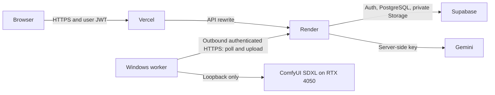

# Phase 4 deployment runbook

This prepares **Vercel → Render → Supabase**, Gemini text, and an authenticated **outbound Windows GPU worker → Render**. No hosted service has been created or deployed by this change. Never point a cloud service at the PC's `127.0.0.1`, expose port 8188, or publish the shared demo account.



## Files and boundaries

| Component | Configuration |
| --- | --- |
| Vercel | Project root `frontend`, `frontend/vercel.json`, `frontend/.env.production.example` |
| Render | Repository-root `render.yaml`, service root `backend`, `backend/.env.production.example` |
| Database | Five ordered files in `supabase/migrations/`; new Phase 4 migration ends in `005_public_deployment.sql` |
| Windows worker | `backend/.worker.env.example`, `python -m app.worker` |
| Verification | `tests/test_supabase_live.py`, `tests/test_deployed_live.py`, [Phase 4 validation](phase-4-validation.md) |

The Render Blueprint explicitly chooses `plan: free`, one process, no disk, no managed database and no paid worker. It disables automatic deployment, public writes and SDXL at first. AMD is the selected text provider and remains unavailable until its private key is configured. Review each dashboard's plan/eligibility/limits before confirming creation. Stop if any account requires a paid resource; no spending is authorized. Keep billing disabled for the Gemini project. Account creation, repository access and final deployment require the operator.

All durable stories, drafts, generation leases, moderation reports and image queue state live in Supabase PostgreSQL. All durable cloud media lives in its private `story-media` bucket. Render uses memory/temporary request buffers only; it must never use `APP_MODE=demo` or a persistent local-data workaround. The production validator rejects that configuration. Existing local SQLite stories are **not** migrated or uploaded automatically.

## 1. Repository and accounts — operator action

1. Put this directory in a private Git repository you control and connect that repository to Vercel and Render. The current workspace has no `.git` directory; no repository/account was created here. Before pushing, check that `.env`, `.env.*`, `.worker.env`, `backend/data/`, test artifacts and dependencies are excluded. Only `*.example` environment templates belong in source control. Never push existing SQLite data, worker spool files or keys.
2. Create/select a **free Supabase project**, then retrieve its project URL, **publishable key** and private **secret key** from Settings > API Keys. Existing legacy anon/service-role JWT pairs remain supported. For compatibility the variable names stay `SUPABASE_ANON_KEY` (publishable/public key) and `SUPABASE_SERVICE_ROLE_KEY` (secret/backend key); modern keys are sent only in the `apikey` header, while signed-in users retain their own JWT in Authorization. See [Supabase API keys](https://supabase.com/docs/guides/getting-started/api-keys). The service-role key goes only to Render and the operator's protected hosted-test configuration.
3. Have two distinct, email-confirmed test accounts available. Use dedicated accounts/project for integration tests; those tests deliberately leave labeled stories and public test files. Do not send passwords, API keys or access tokens in chat.

## 2. Supabase migrations, Auth and moderation

Apply migrations once, in filename order, using the Supabase SQL Editor or a linked Supabase CLI project:

```powershell
supabase link --project-ref YOUR_PROJECT_REF
supabase db push
```

For an existing project apply only missing files; a project already at Phase 3 needs **005 only**. Do not rerun applied migrations. Migration 005 adds tables/functions/policies; it does not delete or rewrite existing stories/chapters/drafts. It adds a capacity trigger to Supabase's `storage.objects`; verify that trigger and actual Storage API behavior in the disposable hosted project before release. Supabase owns object management: upload/delete files through its Storage API, not SQL row deletion.

Enable email/password authentication, keep email confirmation on, disable anonymous sign-ins, review Auth rate limits, and set a strong password policy. Once Vercel gives the final URL, set **Authentication → URL Configuration → Site URL** to `https://YOUR_FRONTEND.vercel.app` and add the exact `https://YOUR_FRONTEND.vercel.app/profile` redirect. Add custom-domain equivalents only when actually used. Do not allow arbitrary preview origins or broad redirect wildcards on the production project.

**Public signup email is an account-setup blocker.** Supabase's default SMTP only delivers to project-team addresses and is unsuitable for unrestricted signup. Configure a custom SMTP provider you already control (or approve a free offering after checking its limits), verify its sender/domain, and test confirmation delivery to both real test addresses. No SMTP provider or charge was provisioned. For an invite-only hackathon you may pre-provision confirmed test accounts; label that mode accurately and do not claim public signup works. See [Supabase SMTP restrictions](https://supabase.com/docs/guides/auth/auth-smtp) and [production checklist](https://supabase.com/docs/guides/deployment/going-into-prod). If enabling Supabase CAPTCHA, first integrate/test its matching frontend widget; this build does not include a CAPTCHA widget, so switching that setting on alone would break authentication.

After a moderator has signed up, copy their **Auth user UUID** and run, as project owner in SQL Editor:

```sql
insert into public.moderators(user_id) values ('MODERATOR_AUTH_USER_UUID')
on conflict do nothing;
```

Ordinary users cannot assign this role. Moderators use `/moderation`, review private reports, and hide/restore stories with an audit reason. Hiding removes a story's public discovery, chapters, panels, Story Bible and referenced public media; owners retain their private uploads. A file still referenced by another visible story remains public there. No chapter history is deleted. Reports are unique per user/story and rate limited. The operator must actively monitor reports; moderation is human, not an automated semantic safety guarantee. Account bans/revocations are handled by the operator in Supabase Auth if needed.

Inspect the `story-media` bucket: **private**, 20-MiB object maximum, allowlisted media types. Vercel/Render requests default to a smaller **4-MiB** cloud upload limit. The same caller JWT is forwarded for ordinary reads/writes, retaining RLS. The backend service identity is limited by application code to job/worker coordination and remote-generated owner uploads; it is never sent to a browser or the GPU PC.

## 3. Render — operator action

Create a Blueprint from `render.yaml` on the free plan, or configure the same web service manually. Use `backend` root, Python 3.13.5, `pip install -r requirements.lock.txt`, and the start command in the Blueprint. Secrets must be entered directly in Render's environment editor. No local `.env` is uploaded.

| Variable | Value / action |
| --- | --- |
| `APP_ENVIRONMENT` / `APP_MODE` | `production` / `supabase`; required |
| `SUPABASE_URL`, `SUPABASE_ANON_KEY`, `SUPABASE_SERVICE_ROLE_KEY` | Matching hosted project; backend only for service key |
| `CORS_ORIGINS` | JSON array of exact frontend HTTPS origins, e.g. `["https://your-project.vercel.app"]` |
| `PUBLIC_WRITES_ENABLED` | Initially `false`; set `true` only after account/storage/moderation checks |
| `MODERATION_READY` | Set `true` after assigning/confirming an actual moderator |
| `AI_MODE` | `amd` primary; `gemini` explicit fallback; `demo` disables real text generation. No automatic provider switching |
| `AMD_API_KEY`, `AMD_MODEL`, `AMD_BASE_URL` | Private backend key; `DeepSeek-V4-Flash`; `https://developer.amd.com.cn/radeon/api/v1`. See [AMD setup](amd-token-factory.md) and [validation status](amd-validation.md) |
| `GEMINI_API_KEY` | Private key for the confirmed unpaid/free-tier project |
| `GEMINI_FREE_TIER_CONFIRMED` | `true` only for that confirmed unpaid project |
| `GEMINI_MODEL` | `gemini-3.5-flash-lite`; preserve the working provider/schema handling |
| `AI_USER_DAILY_LIMIT`, `AI_GLOBAL_DAILY_LIMIT`, `AI_REQUESTS_PER_MINUTE` | Conservative cloud defaults `3`, `25`, `1` |
| `SDXL_EXECUTION`, `SDXL_API_FLAVOR` | `worker`, `comfyui` |
| `SDXL_ENABLED` | Initially `false`; enable after configuring/authenticating the local worker |
| `WORKER_TOKEN` | Blueprint-generated random 256-bit value; share privately only with the worker |
| `WORKER_LEASE_SECONDS` / `WORKER_ONLINE_SECONDS` | `300` / `45` |
| `MAX_UPLOAD_BYTES` | `4194304` (4 MiB); do not silently raise public storage limits |

Render health checks use `/api/ready`. It verifies migration 005's readiness RPC, a private storage bucket and, when public writes are enabled, an assigned moderator. Missing migrations/access yield 503 and should stop release. `/api/health` describes configuration, not successful live model inference. Confirm the service's HTTPS URL and verify HTTP redirects before advertising it. Free hosting can cold-start; wait for readiness rather than interpreting a cold request as generated content. No availability guarantee has been measured here.

## 4. Vercel — operator action

Import the same repository, choose **Next.js**, and set **Root Directory = frontend**. Configure these environment values in Vercel (Production only until previews have their own intended backend/project):

```dotenv
STORYVERSE_PUBLIC_DEPLOYMENT=true
API_INTERNAL_URL=https://YOUR_BACKEND.onrender.com
NEXT_PUBLIC_SUPABASE_URL=https://YOUR_PROJECT.supabase.co
NEXT_PUBLIC_SUPABASE_ANON_KEY=YOUR_PUBLISHABLE_KEY_OR_LEGACY_ANON_JWT
```

Never set `NEXT_PUBLIC_AMD_API_KEY`, `NEXT_PUBLIC_GEMINI_API_KEY`, a public worker token, or a public Supabase service key. The API origin is a server build setting; redeploy after changing it. Production builds reject missing credentials/HTTP or localhost backend origins. The browser uses same-origin `/api/*` rewrites and forwards its bearer JWT to Render. HTTPS/security headers and non-cacheable API responses prevent private drafts from entering shared caches. Arbitrary CORS origins and redirects are not enabled.

Image creation returns **202 + job ID**, then short authenticated status polls. It does not depend on a long Vercel request or on the local Next proxy timeout: Vercel [external rewrites have a maximum request duration](https://vercel.com/docs/limits#proxied-request-timeout). Text generation retains its existing bounded 45-second provider operation and explicit errors; cloud cold starts/network waits still require live testing.

## 5. Windows outbound SDXL worker — operator action

ComfyUI remains bound to **127.0.0.1:8188** on the PC. **No inbound port, public ComfyUI tunnel, Cloudflare tunnel/account or paid GPU service is needed.** Do not forward port 8188 or expose ComfyUI's unrestricted API.

From the existing `backend` directory, preserve `.env` and create the separate worker configuration:

```powershell
Copy-Item .worker.env.example .worker.env
.\.venv\Scripts\python.exe -c "import uuid; print(uuid.uuid4())"
```

Edit `.worker.env` privately: set `WORKER_BACKEND_URL` to the real HTTPS Render origin; copy Render's `WORKER_TOKEN`; use the generated UUID as `WORKER_ID`. Keep the existing checkpoint and local ComfyUI endpoint. Run:

```powershell
.\.venv\Scripts\python.exe -m app.worker
```

Protect `.worker.env` and `data/worker-spool/` with your Windows user account permissions. The worker receives only its assigned panel description, fictional appearance notes, seed and settings; it never receives Gemini keys, caller JWTs or Supabase credentials. It uses the existing local ComfyUI adapter at 768×768, 20 steps, batch one, no refiner; backend/worker settings must agree. Its 240-second render timeout leaves room inside the 300-second lease for upload. Do not run another ComfyUI client during the demo.

Enable `SDXL_ENABLED=true` on Render and let the worker poll. Idle polls update a heartbeat; the worker must reach the backend before image requests are accepted. Authentication uses a strong bearer token checked with constant-time comparison. Each lease also has a random identifier in a header, not a URL. Worker credentials authorize only claim/result/failure routes, not general database/admin operations. Keep access logs disabled as in the Blueprint and rotate the token on both ends if compromised.

The durable PostgreSQL reservation and queue permit **one active image lease across workers**. Completion rechecks the lease, owner, draft revision and story version, validates the PNG and strict metadata, uploads to Supabase Storage with an owner-private path, and atomically creates a new version through existing publication-safe RPCs. Previous images remain private unless explicitly referenced in an approved chapter. Metadata retains checkpoint, seed, sampler/scheduler, ComfyUI execution ID, prompt/image hashes and provenance.

The worker also locks its spool directory for the lifetime of its process; a second local instance using that directory is rejected. Lease/result records are replaced atomically. Windows releases the process lock on exit; do not manually remove spool files while the worker runs.

Result uploads retry the **same locally spooled bytes/job ID** after transient failures; they do not render again. On process interruption without a saved PNG, the reservation fails or expires rather than silently executing twice. Expired/stale callbacks are rejected. GPU inference itself has no automatic retry: a user explicitly requests another version. A storage write followed by a stale-result rejection can leave an owner-private orphan; operator cleanup is outside automated publishing. Do not delete active files/spools.

If the PC/worker is offline, new requests return `worker_offline` without reserving generation quota, and Studio preserves descriptions/media for retry. If it disconnects mid-job, the durable lease expires and the UI reports failure. Reopening a source draft resumes polling its pending job; completed callback replay is idempotent even when the worker is subsequently offline. Polling is not a paid background worker; the PC must stay awake and connected. Cloud-to-PC inference remains **unverified until this exact hosted path is exercised**.

## 6. Bounds and operational controls

- Email-confirmed users only in production; user identity comes from Supabase Auth's verified response, never request body IDs.
- Existing durable Gemini/image quotas are shared across all backend workers and include failed reservations. Cloud defaults allow three jobs per user/day and 25 total/day, one reservation per user/minute. Generation and edited-chapter analysis are separate jobs; watch the cap during demos.
- Database triggers cap manual stories at five/user/day, contributions and chapters at 30/user/day, and upload metadata at 20/user/day, including direct Supabase RPC/table requests.
- The private bucket has a **30-object total capacity** for this hackathon configuration, including orphan objects (at most 600 MiB with its 20-MiB per-object ceiling). The storage insert trigger also applies to privileged worker uploads. This is intentionally conservative and independent of daily quotas; increase only after reviewing hosted storage limits and approval. Existing objects are not deleted by the migration and may already exceed the cap, in which case new uploads are blocked.
- Reports are limited to ten distinct stories per user/day. Duplicate reports do not inflate priority. Only manually assigned moderators can read reports or change visibility; decisions are audited.
- API bodies and authorization headers are bounded. A single configured API process has a bounded global 600-request/minute in-memory circuit breaker. It is **not** an IP/Sybil-proof or distributed DDoS shield; durable user/write/generation quotas are the primary application limits. Configure provider-side protections as appropriate before a large public launch.
- CORS is not authentication. Direct clients still need valid caller JWTs and face database policies/quotas. `PUBLIC_WRITES_ENABLED=false` pauses API mutation routes (reports/moderation remain available); it does not revoke already issued Supabase credentials or replace project-level emergency controls. For a full incident pause disable signup, revoke/ban affected Auth accounts or restrict direct database writes using project-owner controls.
- Prose is rendered as text, media MIME/signatures are allowlisted, SVG/HTML uploads are rejected, structured AI output remains Pydantic-validated and continuity/version checks remain active. Uploaded media and semantic AI output are not automatically classified; human review/reporting is still required.

## 7. Hosted and public verification — wait for access

Create an ignored `backend/.env.hosted` from `.env.production.example`, with actual hosted project values and confirmed test accounts. Set moderation readiness/public writes to true only after the moderator is assigned. Add these **private test-only** variables:

```dotenv
SUPABASE_TEST_EMAIL_A=
SUPABASE_TEST_PASSWORD_A=
SUPABASE_TEST_EMAIL_B=
SUPABASE_TEST_PASSWORD_B=
STORYVERSE_PUBLIC_API_URL=https://YOUR_BACKEND.onrender.com
```

Then, from `backend/`, opt in to real hosted Auth/Storage/RLS testing:

```powershell
$env:STORYVERSE_LIVE_ENV_FILE=".env.hosted"
$env:STORYVERSE_LIVE_TESTS="1"
.\.venv\Scripts\python.exe -m pytest tests/test_supabase_live.py -q --tb=no -p no:cacheprovider
Remove-Item Env:STORYVERSE_LIVE_TESTS
```

That test uses two confirmed users and actual project storage, private drafts/files, publication conflicts, public files, interactions and reading state. It does not prove cloud Gemini/worker access. Only after its success, opt in to the deployed API workflow:

```powershell
$env:STORYVERSE_DEPLOYED_TESTS="1"
$env:STORYVERSE_DEPLOYED_AI="1"
$env:STORYVERSE_DEPLOYED_SDXL="1"
.\.venv\Scripts\python.exe -m pytest tests/test_deployed_live.py -q --tb=no -p no:cacheprovider
Remove-Item Env:STORYVERSE_DEPLOYED_TESTS,Env:STORYVERSE_DEPLOYED_AI,Env:STORYVERSE_DEPLOYED_SDXL
```

This executes real deployed generation only with these explicit flags. It honors the default minute cap, waits for remote results and verifies private-before/public-after image access plus the downloaded hash. Leave the SDXL flag unset until the GPU worker is connected. Inspect sanitized API error codes on failure; never attach `.env`, request headers, JWTs or raw provider exceptions to a report.

Public browser checklist, using a desktop browser plus an independent device/browser (not only Playwright emulation):

1. Visit the actual Vercel HTTPS URL while signed out; check that no shared demo user is present.
2. Sign up a new email address, receive/confirm the email, sign in, and verify that another account cannot open its draft or unpublished image. Test expired sessions and sign-out.
3. Create a labeled test opening, contribute text, consent to Gemini, inspect genuine chapter/panel descriptions, edit/preview and save.
4. With the worker running, generate/regenerate one SDXL panel. Record native ComfyUI execution IDs, image dimensions, latency and persisted hashes. Restart the backend and verify the selected draft/image still loads.
5. Explicitly approve publication. Check both public readers on desktop/mobile and the other device; try publishing an older version and confirm a conflict.
6. Stop **only the StoryVerse worker**, leave ComfyUI private, request another image, and confirm an offline error preserves the draft. Reconnect and retry explicitly. Test worker termination during a job and late callback rejection on the disposable story.
7. File a report with a normal account; sign into the assigned moderator account, hide the test story, and confirm another user cannot read its prose/media through either Render or direct Supabase APIs. Restore it and check the audited action.
8. Check Auth/SMTP limits, remaining quotas, upload capacity, HTTPS redirects, response cache headers and the absence of credentials in browser bundles/logs. Only then declare the hosted path verified and open public writes to intended participants.

Until the operator supplies/configures these accounts, URLs, credentials and deployment authorization, **hosted Supabase, public signup, deployed Gemini, remote SDXL and cross-device public access remain pending**. Local successful inference from earlier reports is not a substitute.
